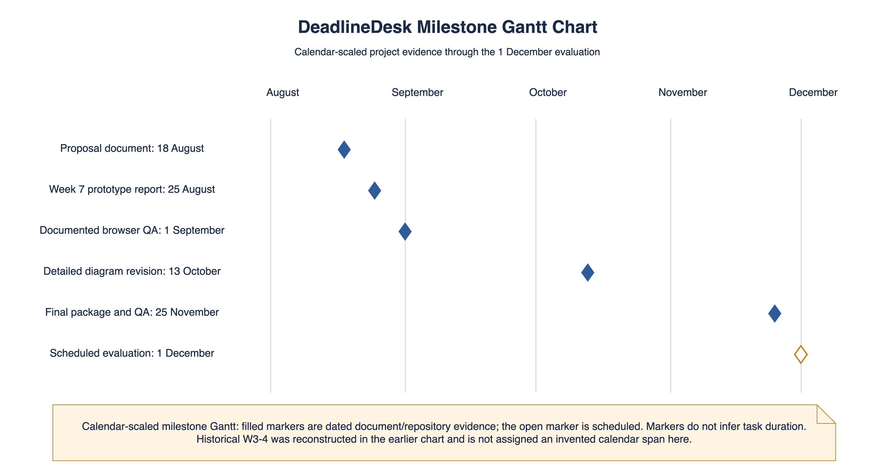

# Gantt chart

[PDF](gantt-chart.pdf) · [PNG](gantt-chart.png) · [Editable draw.io source](gantt-chart.drawio)

The calendar-scaled milestone Gantt uses the proposal date (18 August), prototype report date (25 August), documented browser QA (1 September), October diagram revision and final November preparation. Filled markers represent dated evidence; the open December marker is scheduled. Markers do not invent task durations or weekly contributions. The earlier Week 3-4 reconstruction remains in the archived Week 7 schedule and is not assigned an invented calendar span in this final chart.
