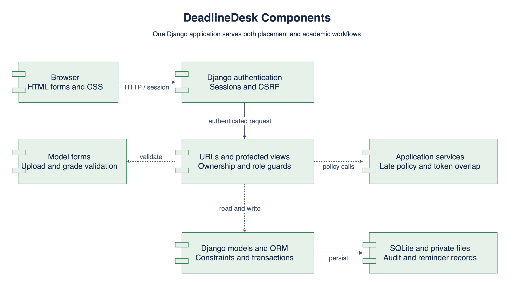

{ .tiet-logo }

# DeadlineDesk

UCS503P Software Engineering, Thapar Institute of Engineering and Technology.

DeadlineDesk combines placement-round readiness and academic assignment deadlines. Placement administrators publish rounds and required checklists. Students track readiness and submit academic work. The assignment's TA applies a published late policy, reviews accepted work and publishes grades and feedback.

**Team:** Aryan Gupta (1024030764), Aksh Goyal (1024030766), Naveen Bansal (1024030767).

**Final evaluation:** Tuesday, 1 December 2026, 8:00 AM, Lab 105.

## Final submission

| Deliverable | Open |
|---|---|
| Final report, LaTeX and PDF | [Report](submission/08-final-report/README.md) |
| Final presentation and inline slides | [Presentation](submission/09-final-presentation/README.md) |
| Eight UML diagram types | [Individual diagram folders](uml/README.md) |
| Gantt chart | [PDF and preview](gantt-chart/README.md) |
| Test cases | [Catalogue and recorded results](test-cases/README.md) |
| Individual journals | [Team journal index](journals/README.md) |
| Working application | [Public demo and startup guide](live-demo.md) |
| Verification | [Application, browser and publication evidence](final-verification.md) |
| All deliverables, including proposal and prototype | [Complete submission index](submission/index.md) |

The final presentation covers Introduction, Background, Problem Statement, Your Solution, and Results in that order. The report includes a dedicated design and evaluation section containing all eight UML diagrams, the Gantt chart and the complete test-case catalogue.

## Architecture and workflows

The frontend uses Django HTML templates and CSS. Python views, forms and services implement the backend. Django's ORM stores structured records in SQLite, while private uploads use a local media directory. Session authentication, CSRF protection, role checks and assignment ownership checks protect the workflows.



The placement workflow is company and draft round creation, required checklist definition, publication, reminder-log persistence and student readiness. The academic workflow is assignment publication, validated upload, server-time late-policy decision, review, grading and student feedback.

See the [architecture and design](design.md), [SRS](srs.md), [current backlog](backlog.md) and [final demo guide](live-demo.md).

GitHub Pages serves these documents and previews. The Python application runs separately at the temporary public demo linked above. Its host and HTTPS tunnel must stay running.

## Milestone records

- [Proposal PDF and LaTeX](submission/02-project-proposal/README.md), with the [proposal presentation PDF](https://github.com/aryanorastar/ucs503p-202627-deadlinedesk/blob/master/w4/presentation.pdf).
- [Prototype report PDF and LaTeX](submission/06-week7-prototype-report/README.md), with the [Week 7 presentation PDF and previews](submission/01-presentation/README.md).
- [Detailed diagrams from the Week 7 baseline](submission/07-planning-and-model-diagrams/README.md), including supporting DFD and ER models.

## Run locally

Use Python 3.11 or newer from the repository root:

```shell
python3 -m venv .venv
./.venv/bin/python -m pip install -r requirements.txt
./.venv/bin/python code/manage.py migrate
./.venv/bin/python code/manage.py seed_demo
./.venv/bin/python code/manage.py runserver
```

Open <http://127.0.0.1:8000/>. The [live-demo guide](live-demo.md) lists the synthetic demo accounts and the separate Gunicorn deployment runner.

[Source repository](https://github.com/aryanorastar/ucs503p-202627-deadlinedesk) · [Submission checklist](FINAL_SUBMISSION_CHECKLIST.md)
