# Final project presentation

[View the PDF](DeadlineDesk_Final_Presentation.pdf) · [Editable PowerPoint](DeadlineDesk_Final_Presentation.pptx) · [Deck source](https://github.com/aryanorastar/ucs503p-202627-deadlinedesk/blob/master/scripts/build_final_presentation.mjs)

Evaluation: **1 December 2026, 8:00 AM, Lab 105**. The presentation follows the required order: Introduction, Background, Problem Statement, Your Solution, Results.

The 16 slides cover the implemented application, eight UML types, schedule, 36 passing automated cases and the demonstration setup. The public application uses a temporary tunnel; see the [current live demo instructions](../../live-demo.md) for availability and restart details.

## Slide previews

### 1. DeadlineDesk

Introduction

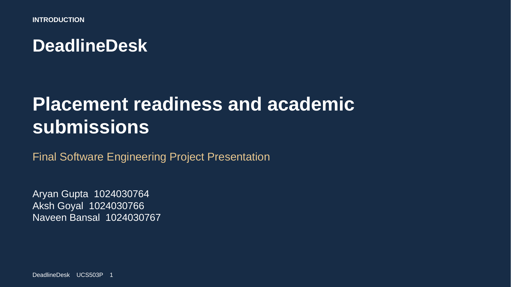

### 2. Two workflows, one account

Introduction

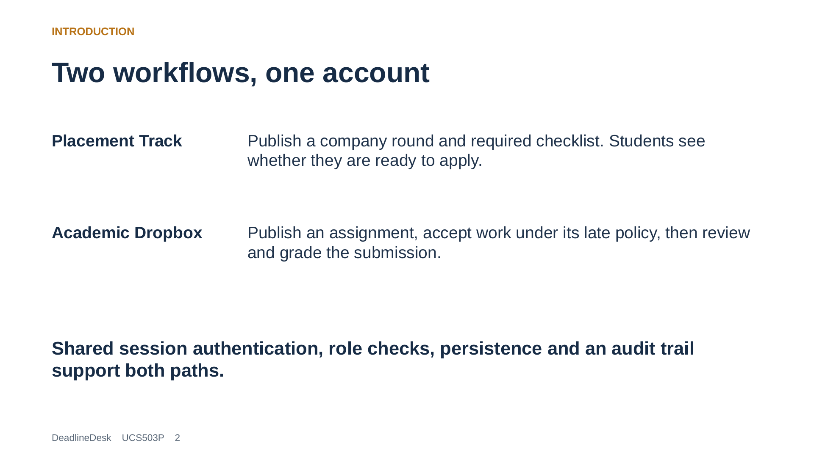

### 3. Campus deadline work

Background

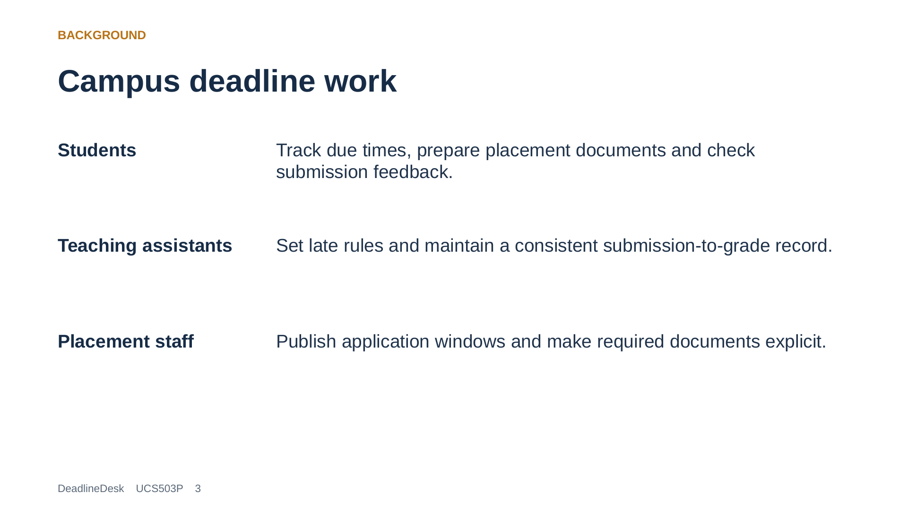

### 4. Implementation stack

Background

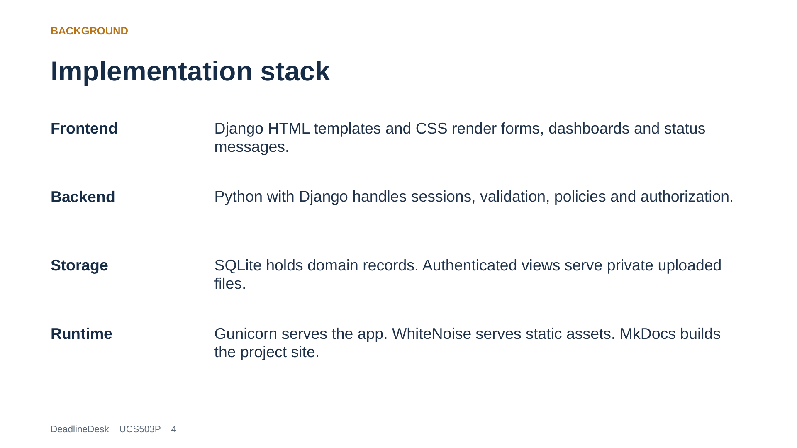

### 5. Deadline decisions need enforceable rules

Problem Statement

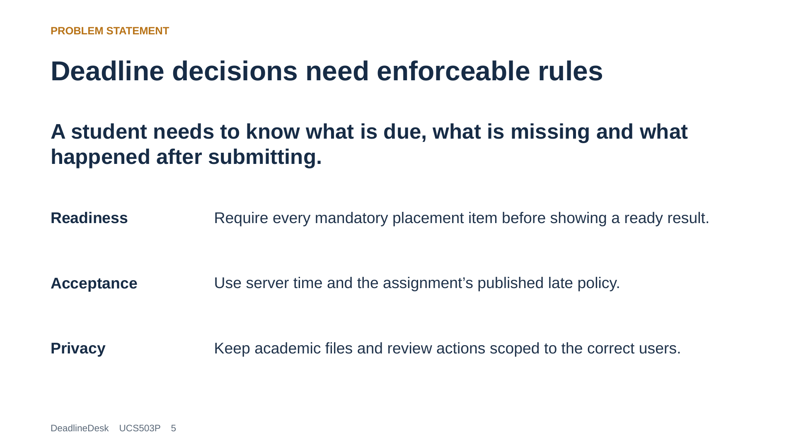

### 6. Roles and access boundaries

Your Solution

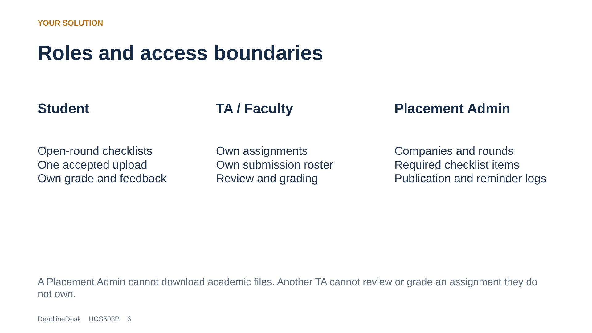

### 7. Application architecture

Your Solution

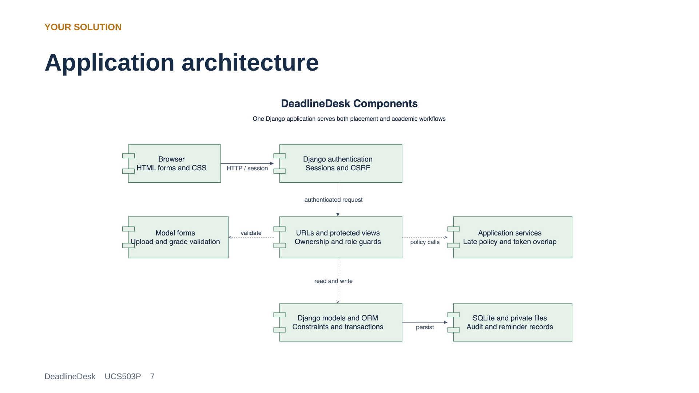

### 8. Placement readiness

Your Solution

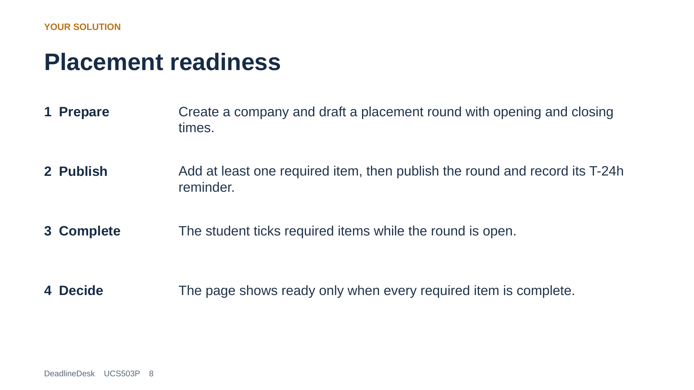

### 9. Academic submission and grading

Your Solution

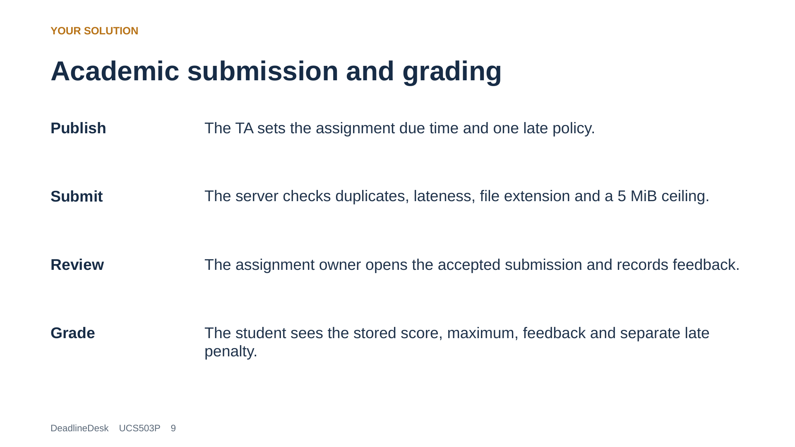

### 10. Late-policy decisions

Your Solution

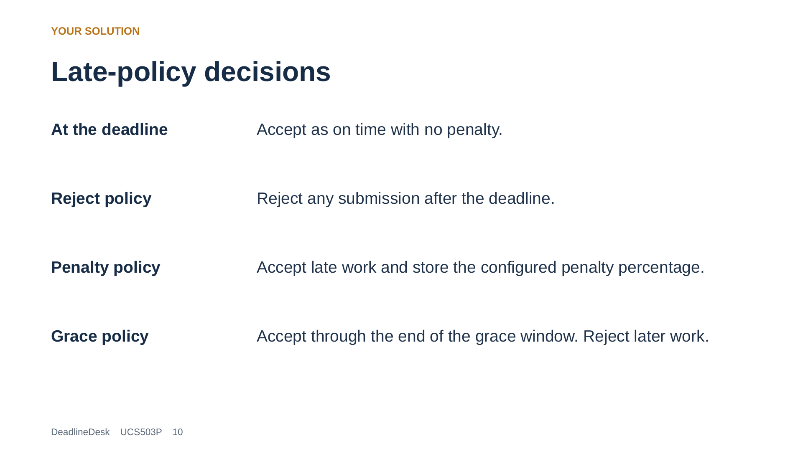

### 11. Data relationships and state

Your Solution

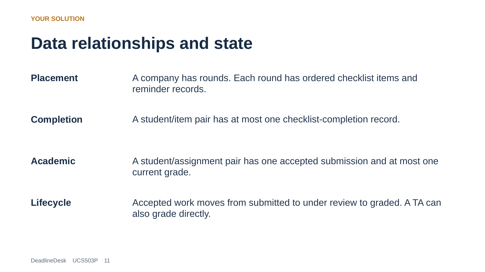

### 12. Eight UML views

Your Solution

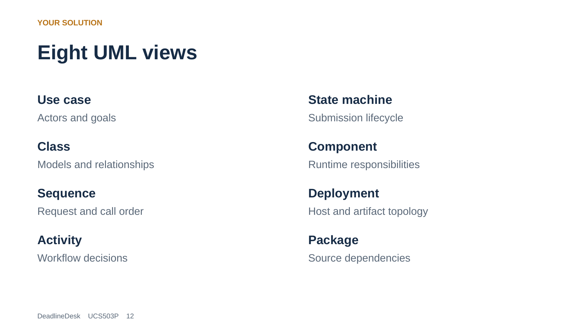

### 13. Demonstration deployment

Your Solution

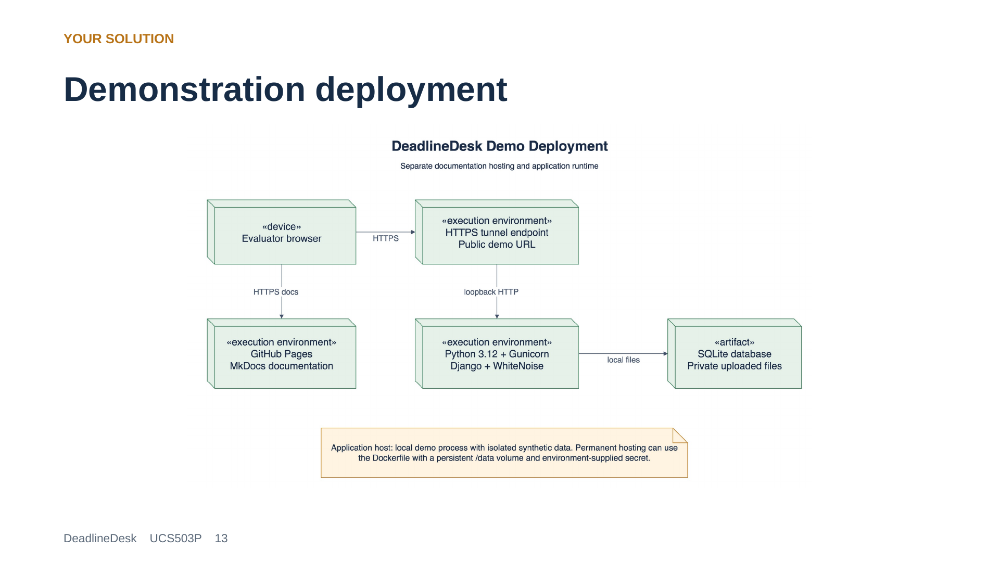

### 14. Project schedule

Your Solution

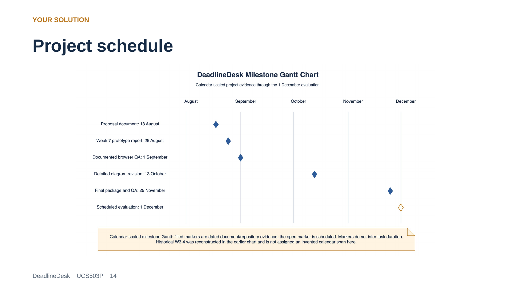

### 15. 36 automated cases pass

Results

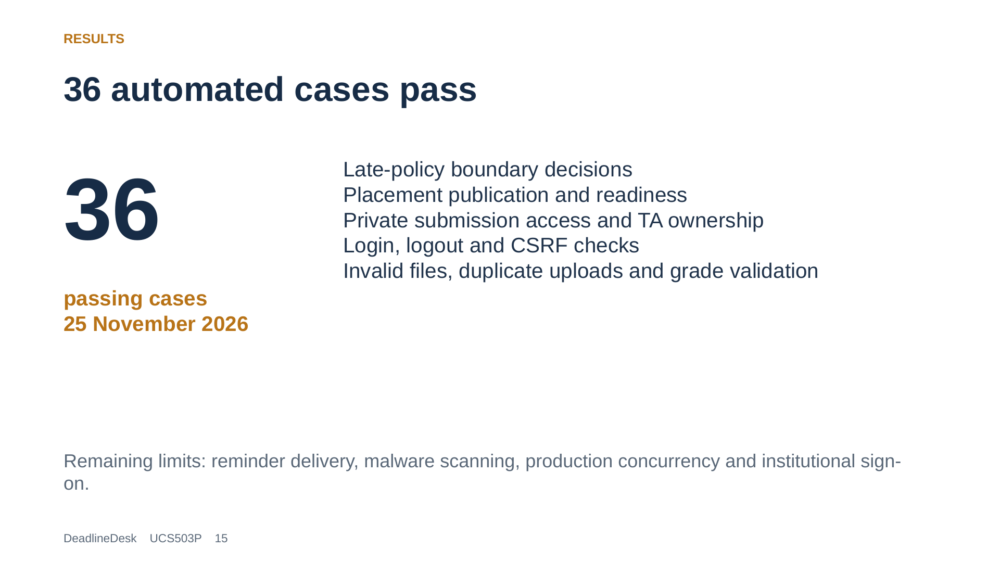

### 16. Live workflows verified

Results

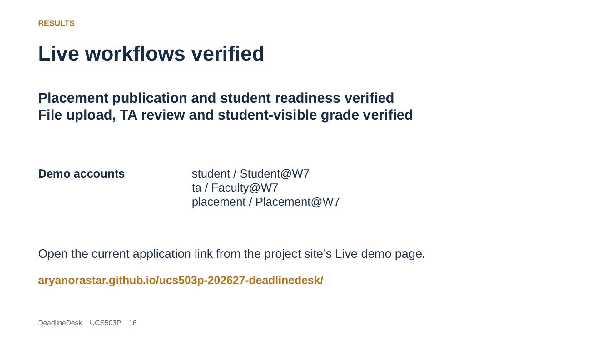
