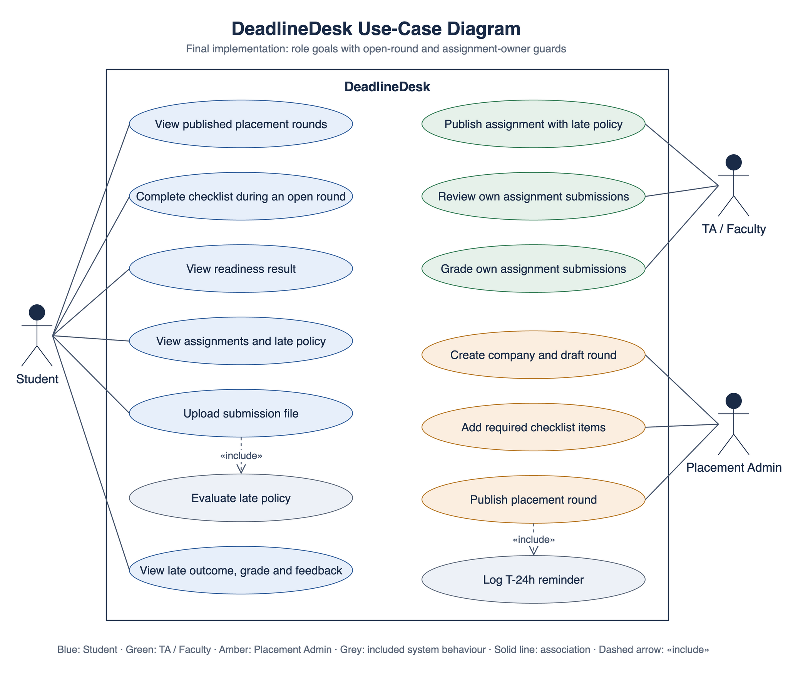

# Use-case diagram

Actors and user goals for the final implementation. Student checklist changes require an open round. TA review and grading require assignment ownership.

[Editable draw.io source](diagram.drawio) · [PDF](diagram.pdf) · [PNG](diagram.png)

[All eight UML types](../README.md)
