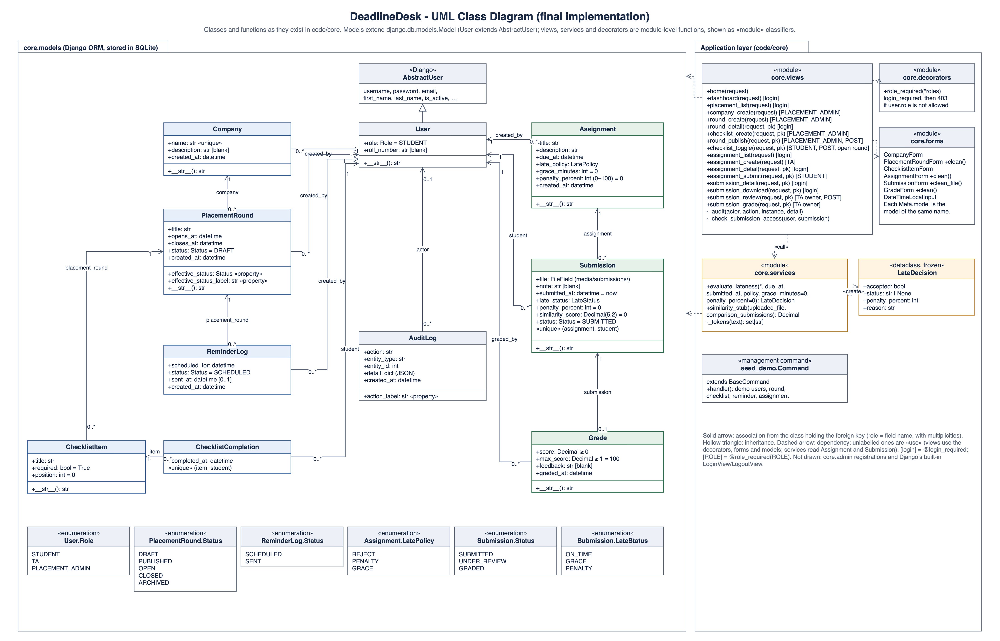

# Class diagram

Implemented Django models, forms, services and view modules. Field and relationship details come from code/core/models.py. Final view guards restrict academic data to its student and assignment owner. The vector PDF preserves all field details for zooming.

[Editable draw.io source](diagram.drawio) · [PDF](diagram.pdf) · [PNG](diagram.png)

[All eight UML types](../README.md)
