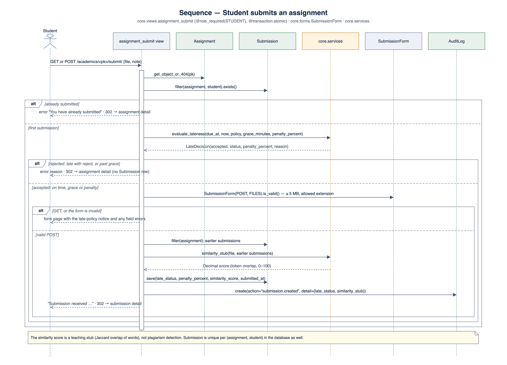

# Sequence diagram

Assignment submission: duplicate check, server-time late policy, file validation, similarity calculation and persistence. Supplementary authentication, placement and grading sequences remain in the detailed diagram index.

[Editable draw.io source](https://github.com/aryanorastar/ucs503p-202627-deadlinedesk/blob/master/project-proposal/figures/sequence-submission.drawio) · [PDF](https://github.com/aryanorastar/ucs503p-202627-deadlinedesk/blob/master/project-proposal/figures/sequence-submission.pdf) · [PNG](https://raw.githubusercontent.com/aryanorastar/ucs503p-202627-deadlinedesk/master/project-proposal/figures/sequence-submission.png)

[All eight UML types](../README.md)
