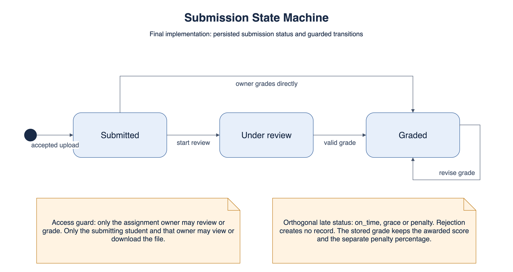

# State-machine diagram

Submission lifecycle from core/views.py. Rejected attempts never become Submission records. Late status is an independent attribute. A TA may grade directly or revise a grade, but starting review cannot downgrade a graded submission.

[Editable draw.io source](diagram.drawio) · [PDF](diagram.pdf) · [PNG](diagram.png)

[All eight UML types](../README.md)
