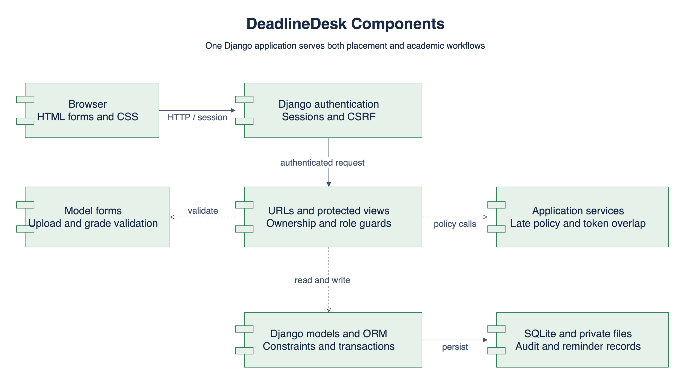

# Component diagram

Actual Django application boundaries, static-file serving and persistence. Reminder delivery and external plagiarism services are outside the implemented system.

[Editable draw.io source](diagram.drawio) · [PDF](diagram.pdf) · [PNG](diagram.png)

[All eight UML types](../README.md)
