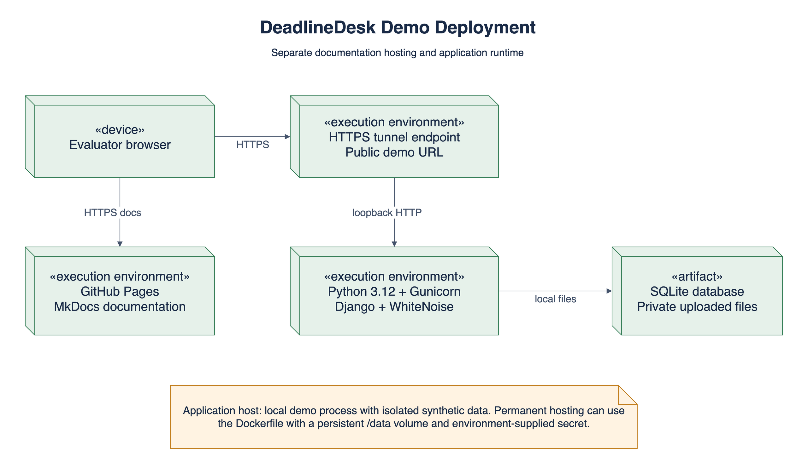

# Deployment diagram

Demo deployment topology. The application runs under Gunicorn with debug disabled. A temporary HTTPS tunnel exposes the synthetic demo. GitHub Pages hosts documentation separately. The tunnel requires the host to remain running.

[Editable draw.io source](diagram.drawio) · [PDF](diagram.pdf) · [PNG](diagram.png)

[All eight UML types](../README.md)
