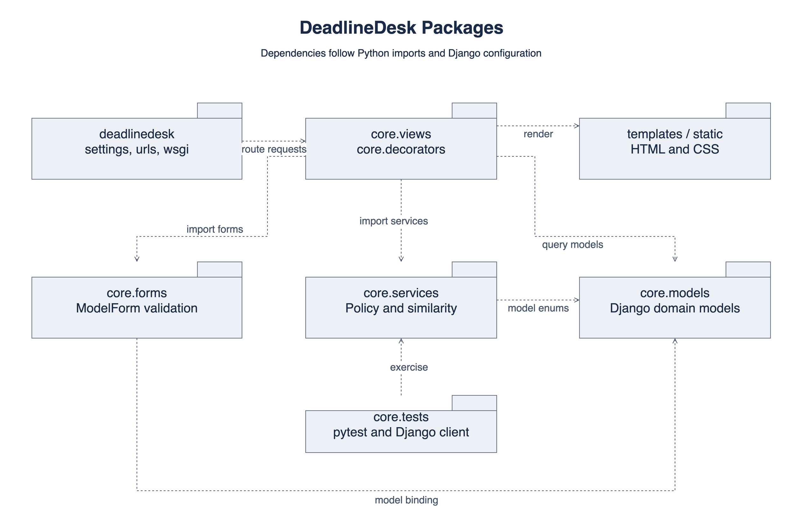

# Package diagram

Code-level Python package and module dependencies. Django templates and static assets form the presentation resources. This diagram describes existing source organization.

[Editable draw.io source](diagram.drawio) · [PDF](diagram.pdf) · [PNG](diagram.png)

[All eight UML types](../README.md)
